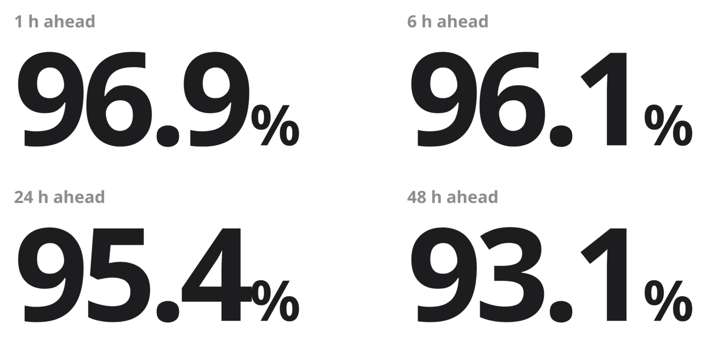
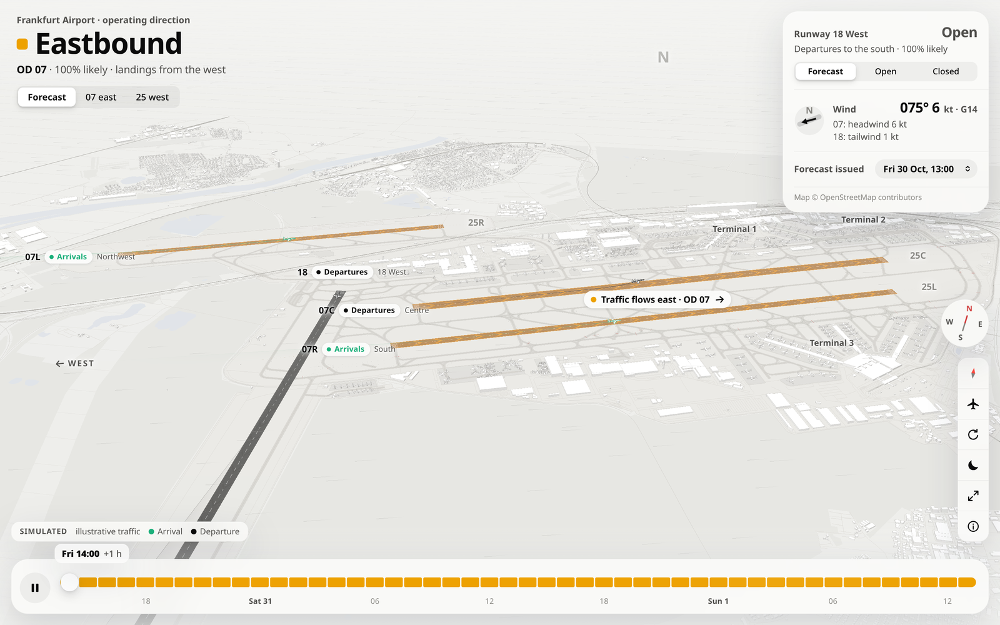
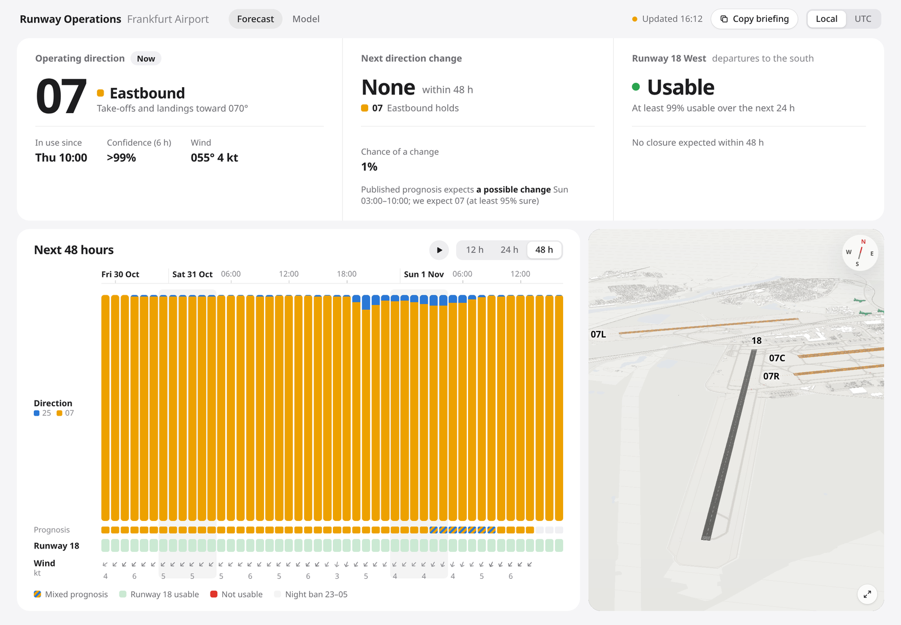

# Eastbound or Westbound?

**Frankfurt Airport's operating direction, forecast 48 hours ahead.**
Built for the FraAlliance challenge at AI Week Frankfurt, 30 Oct 2026, in about 6 hours.

<p align="center">
  <picture>
    <source media="(prefers-color-scheme: dark)" srcset="assets/screenshots/accuracy-dark.png">
    
  </picture>
</p>

Share of hours where the forecast direction matched the direction that was actually flown. That is more accurate than both the published Umwelthaus prognosis and the official rules at every lead time.

---

## Why it matters

Frankfurt runs its whole runway system in one direction: westbound (**OD 25**) or eastbound (**OD 07**). When the wind turns, every runway switches at once. Strong north wind also closes **Runway 18 West**, which handles 6 out of 10 departures.

> **Today:** the wind turns, a limit is reached, and the switch is decided at short notice.
>
> **With this forecast:** the switch is known up to 48 h ahead, so it can be planned.

- **Lufthansa** can protect connections at its largest hub and plan flights proactively.
- **Fraport** can pre-position staff and ground handling, and plan around a Runway 18 closure.

For every hour up to 48 h ahead, the model gives the probability of each operating direction and of Runway 18 being available. It also gives the next likely change time and a certainty score.

| FRA at a glance | |
| --- | --- |
| Passengers (2025) | 63 M |
| Flight movements per year | 460,000 (~1,260 per day) |
| Direction changes per year | 156 |
| Share of movements by direction | 61 % west (OD 25) · 39 % east (OD 07) |
| Departures from Runway 18 West | 6 out of 10 |

## The product

<p align="center">
  
</p>

**3D view.** You can see which way traffic flows now, which runways handle arrivals and departures, whether Runway 18 West is open, and the 48-hour timeline you can scrub through.

<p align="center">
  
</p>

**Forecast dashboard.** It shows the current direction with its confidence, the next likely change, Runway 18 availability, and each of the next 48 hours next to the published prognosis and the wind.

To try it without installing anything, download the repository and open [`submission/dashboard.html`](submission/dashboard.html) in a browser. It works offline, with no server needed; the 3D view next to the timeline is [`submission/airport3d.html`](submission/airport3d.html).

## Results

Accuracy of the operating direction, scored against the direction actually flown. Test period: 15 Sep – 30 Oct 2026, 1,043–1,090 forecasts per lead time.

| Lead time | **Our model** | Published Umwelthaus prognosis | Official rules (case section 3) | Naive "no change" |
| --- | :---: | :---: | :---: | :---: |
| 1 h | **96.9 %** | 95.1 % | 92.9 % | 96.3 % |
| 6 h | **96.1 %** | 93.7 % | 89.7 % | 88.8 % |
| 24 h | **95.4 %** | 92.0 % | 90.4 % | 72.5 % |
| 48 h | **93.1 %** | 89.8 % | 89.0 % | 67.0 % |

- **Next direction change: 80 % right.** This counts both correct "no change" calls and changes predicted within ±3 h of when they happened. The published prognosis gets 73 % and the official rules 60 %. When a change does happen, the model places it within ±3 h in 73 % of cases, with a mean timing error of 1.1 h. The model raises 47 false alarms; the rules raise 170.
- **The probabilities can be trusted.** When the model says 90 %, it is right about 90 % of the time. Brier score: 0.022 / 0.030 / 0.035 / 0.046 at 1 / 6 / 24 / 48 h.
- **Runway 18.** Real closures are rare: north-wind events on 3–4 days in 16 months. The model flags about half of all closure hours, including every wind-driven closure we could score, with about 1 false alarm per 1,000 h. The official gust rule gives about 20. With so few events, treat these numbers as indicative.

Full tables, key drivers and limitations are in the [model card](MODEL_CARD.md).

## How it works

1. **Labels: what was actually flown.** The flown direction comes from radar tracks. An aircraft below 3,000 ft within 15 km of the airport heading ~250° means OD 25, and heading ~070° means OD 07. A southbound departure west of the field is a Runway 18 departure.
2. **Inputs for each forecast hour (1–48 h ahead):**
   - the tailwind on runway 25 from ECMWF and DWD ICON-D2, hourly and smoothed, at 10 m and 100 m;
   - a wind-regime indicator (NE "Bise" or SE pre-frontal easterly);
   - the official rule applied to the forecast;
   - the published Umwelthaus prognosis;
   - the direction flown in the last hour;
   - the time of day, including the night ban.
3. **Direction model:** a regularised logistic regression with separate weights for short and long lead times. It is retrained on the most recent 120 days, and its probabilities are calibrated out of sample (temperature scaling per lead bucket).
4. **Runway 18 model:** a logistic regression on the official rule, gust and mean tailwind on runway 18, the observed wind, and current use.
5. **Why so simple:** with only weeks of hourly labels, gradient boosting and larger feature sets did worse in walk-forward tests. About 60 variants were tested in four parallel studies; see [experiments/](experiments/) and the decision log in [research/conclusion.md](research/conclusion.md).

### How accuracy was measured

- **Only data available at forecast time.** For a forecast issued at time *t*, the model sees:
  - weather model runs started at least 6 h (ECMWF) or 4 h (ICON) before *t*;
  - the Umwelthaus prognosis as it was published at *t*;
  - METAR weather reports up to *t*;
  - the direction flown in the hour before *t*.
- **Walk-forward testing.** Each test week is predicted by a model trained only on weeks before it.
- **Truth is what was actually flown,** taken from radar tracks. Every method is scored on exactly the same hours.
- **Independent leakage review.** A separate code review searched for look-ahead bugs, and the two it found were fixed before these numbers were produced.

## Data

All public and self-sourced, as the challenge required. The downloaded archives are not part of the repository; the pipeline fetches them into `data/`.

| Data | Source | Coverage |
| --- | --- | --- |
| **Flown direction + Runway 18 use** (labels) | Umwelthaus INAA / FANOMOS radar tracks, [inaa.umwelthaus.org](https://inaa.umwelthaus.org/) | 11,564 labelled hours, Jun 2025 – Oct 2026 |
| Weather forecasts as issued | [Open-Meteo Single Runs](https://open-meteo.com/en/docs/single-runs-api): ECMWF IFS (10 m and 100 m wind) | May 2025 – Oct 2026 |
| Second weather model | Open-Meteo Single Runs: DWD ICON-D2 | May – Oct 2026 |
| Earlier forecast vintages | [Open-Meteo Previous Runs](https://open-meteo.com/en/docs/previous-runs-api) (best match ≈ DWD ICON), issued ≥ 1 day before | 2024 – Oct 2026 |
| Published direction prognosis | Umwelthaus INAA, as published each hour | May 2025 – Oct 2026 |
| Observed weather | [Iowa Environmental Mesonet](https://mesonet.agron.iastate.edu/request/download.phtml) METAR EDDF | 2024 – Oct 2026 |
| Airport geometry (3D view only) | © [OpenStreetMap](https://www.openstreetmap.org/copyright) contributors, ODbL | – |
| Live aircraft (3D view only) | [The OpenSky Network](https://opensky-network.org/) REST API | live |

Weather data by [Open-Meteo.com](https://open-meteo.com/) (CC BY 4.0). Labels are hourly in the test period and 3–6 sampled hours per day before it, because the radar archive answers about 0.4 requests per second.

## Repository layout

| Path | Contents |
| --- | --- |
| [`fra/`](fra) | The pipeline, one module per step (see below) |
| [`tests/`](tests) | Unit tests for the official decision rules, checked against the worked examples in the case |
| [`experiments/`](experiments) | Walk-forward research harness and the four studies behind the design decisions |
| [`research/`](research) | Background research from the start of the day and the decision log |
| [`submission/`](submission) | The package handed to the jury on 30 Oct 2026: 48 h forecast, dashboard, model card, evaluation tables |
| [`site/`](site) | Generated web pages: dashboard (`index.html`), model page (`model.html`), 3D view (`airport3d.html`) |
| [`web/`](web) | Source of the 3D airport view (three.js) |
| [`docs/`](docs) | The challenge brief ([FraAlliance_Case.pdf](docs/FraAlliance_Case.pdf)) |
| [`assets/`](assets) | Icon and README images |

| Step | Module (`fra/`) | Output |
| --- | --- | --- |
| Labels | `labels.py` | Radar tracks → flown direction and Runway 18 use per hour (`data/labels.parquet`) |
| Weather | `weather.py`, `singleruns.py`, `singleruns_icon.py` | METAR observations; ECMWF IFS and ICON-D2 runs as issued |
| Published prognosis | `prognosis.py` | The Umwelthaus prognosis as it was published at each hour |
| Rules baseline | `rules.py` | Wind components and the official decision rules (case section 3) |
| Features | `dataset.py` | One row per (issue time, lead time), using only data available at the issue time |
| Model and evaluation | `train.py`, `changetime.py` | Walk-forward evaluation, next-change timing, the production model |
| Forecast | `predict.py` | 48 h forecast as CSV and chart, for now or any past issue time |
| Outputs | `dashboard.py`, `modelpage.py`, `scene3d.py`, `live.py`, `trackrecord.py`, `report.py`, `submit.py` | Dashboard, model page, 3D view, live feed, 14-day track record, model card, submission package |

## Reproduce the pipeline

Requires Python 3.12 and [uv](https://docs.astral.sh/uv/). Every download step can be resumed. The radar labels are the slow part: the archive answers about 0.4 requests per second, so the full history takes several hours.

```bash
uv sync
uv run pytest                                  # unit tests

# 1. Data -> data/
uv run python -m fra.weather                   # METAR + Open-Meteo previous runs
uv run python -m fra.singleruns                # ECMWF IFS runs as issued
uv run python -c "from fra.singleruns import download_upper_runs; download_upper_runs()"   # ECMWF 100 m wind
uv run python -m fra.singleruns_icon           # DWD ICON-D2 runs as issued
uv run python -m fra.prognosis                 # published Umwelthaus prognosis, as of each hour
uv run python -m fra.labels 2025-06-01T04:00 2026-10-30T11:00 8 2026-09-15   # radar labels: start, end, workers, hourly from
uv run python -m fra.labels --write            # -> data/labels.parquet

# 2. Model
uv run python -m fra.train                     # walk-forward evaluation -> data/eval.csv; final model -> data/model.pkl
uv run python -m fra.changetime                # next-change evaluation -> data/changetime_eval.csv

# 3. Forecast and web pages
uv run python -m fra.predict [ISSUE_UTC]       # 48 h forecast CSV + PNG; past issue times use only data available then
uv run python -m fra.dashboard                 # site/index.html, site/model.html, site/airport3d.html
uv run python -m fra.live &                    # optional: live aircraft + hourly forecast for the 3D view -> site/live.json
uv run python -m http.server 8000 --directory site    # open http://localhost:8000/
uv run python -m fra.submit [ISSUE_UTC]        # submission/: forecast, dashboard, model card, evaluation tables
```

## Limitations

- **Short test period.** Seven weeks in autumn 2026. Sampling noise is about ±0.8 percentage points per lead time, and the results carry no confidence intervals yet.
- **Runway 18 closures are rare.** Only about four wind-closure hours could be scored, so the Runway 18 numbers are indicative. "Closed" is a proxy: no southbound departures in a busy hour.
- **Thin training history.** Before the test period, the labels are 3–6 sampled hours per day, so direction switches between samples are partly missed.
- **Live forecasts approximate the weather run's start time.** Training and evaluation use exact archived runs.

## Next steps

- Extend the radar labels back to 2014. The archive goes back that far, which means many more direction switches, Runway 18 closures and winters to learn from.
- Test on a longer period (hourly radar data exists from February 2026) and add day-block bootstrap error bars.
- Archive every live forecast from 1 November 2026 and score it as a true out-of-sample track record.

---

**Model card:** [MODEL_CARD.md](MODEL_CARD.md) · **Design decisions:** [research/conclusion.md](research/conclusion.md) · **Experiments:** [experiments/](experiments/) · **Submission package:** [submission/](submission/)
