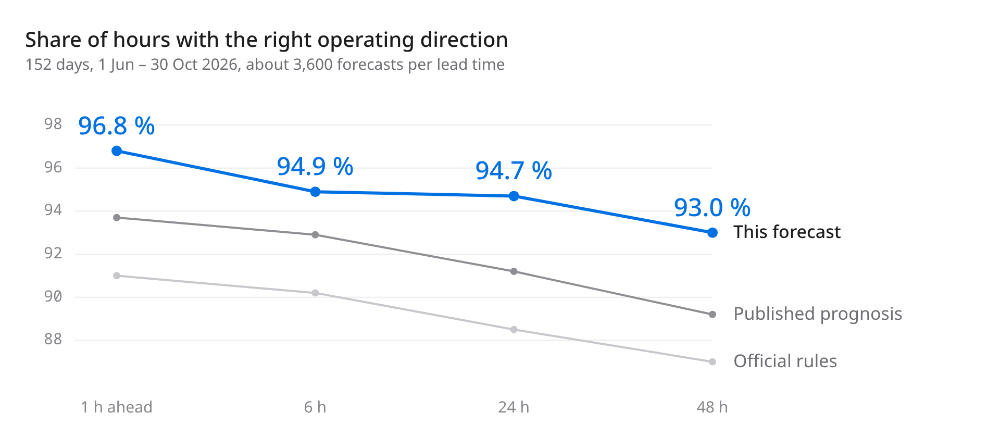
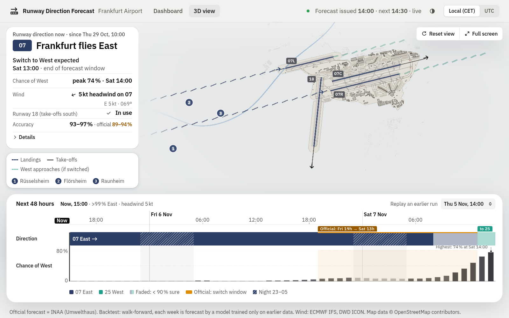
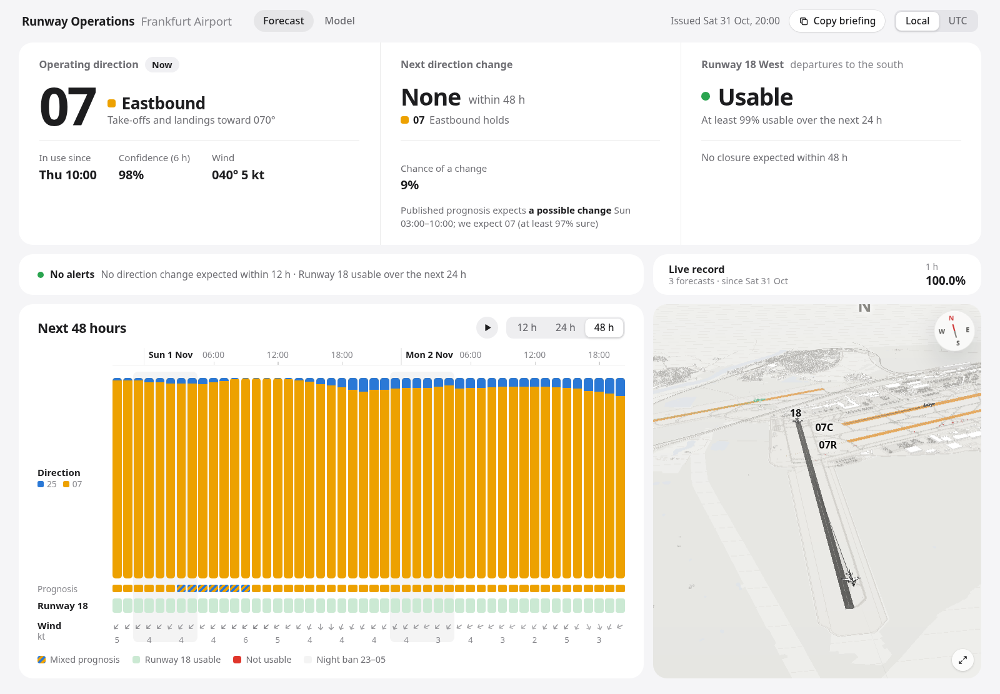

# Eastbound or Westbound?

**Frankfurt Airport's operating direction, forecast 48 hours ahead.**
Built for the FraAlliance challenge at AI Week Frankfurt, 30 Oct 2026, in about 6 hours. Improved since, and issued live every hour since 31 Oct 2026.

> [!NOTE]
> **This is the improved version, not the hackathon submission.** The version handed in at the hackathon on 30 Oct 2026 is the [**v1.0-hackathon** release](https://github.com/jonassneu/fraalliance-hackmeck/releases/tag/v1.0-hackathon); its jury package is also kept unchanged in [`submission/`](submission/). Everything else on this page describes the work done since. What changed is listed in [What changed since the hackathon](#what-changed-since-the-hackathon).

<p align="center">
  <picture>
    <source media="(prefers-color-scheme: dark)" srcset="assets/screenshots/accuracy-dark.png">
    
  </picture>
</p>

Share of hours where the forecast direction matched the direction that was actually flown, on 152 days from 1 Jun to 30 Oct 2026. That is more accurate than both the published Umwelthaus prognosis and the official rules at every lead time. The model was also designed on these days, so the real test is the live record from 1 Nov 2026 (see below).

---

## Why it matters

Frankfurt runs its whole runway system in one direction: westbound (**OD 25**) or eastbound (**OD 07**). When the wind turns, every runway switches at once. Strong north wind also closes **Runway 18 West**, which handles 6 out of 10 departures.

> **Today:** the wind turns, a limit is reached, and the switch is decided at short notice.
>
> **With this forecast:** the switch is known up to 48 h ahead, so it can be planned.

- **Lufthansa** can protect connections at its largest hub and plan flights proactively.
- **Fraport** can pre-position staff and ground handling, and plan around a Runway 18 closure.

For every hour up to 48 h ahead, the model gives the probability of each operating direction and of Runway 18 being available. It also gives the next likely change time and a certainty score.

| FRA at a glance | |
| --- | --- |
| Passengers (2025) | 63 M |
| Flight movements per year | 460,000 (~1,260 per day) |
| Direction changes per year | 156 |
| Share of movements by direction | 61 % west (OD 25) · 39 % east (OD 07) |
| Departures from Runway 18 West | 6 out of 10 |

## The product

<p align="center">
  
</p>

**3D view.** You can see which way traffic flows now, which runways handle arrivals and departures, whether Runway 18 West is open, and the 48-hour timeline you can scrub through.

<p align="center">
  
</p>

**Forecast dashboard.** It shows the current direction with its confidence, the next likely change, Runway 18 availability, and each of the next 48 hours next to the published prognosis and the wind. Since 31 Oct 2026 it is rebuilt every hour from the newest live forecast, with alerts (direction change within 12 h, Runway 18 closure risk within 24 h) and the live record. A second page, **Model**, explains how good the forecast is, how it works and how it was tested.

To try the hackathon version without installing anything, download the [v1.0-hackathon release](https://github.com/jonassneu/fraalliance-hackmeck/releases/tag/v1.0-hackathon) (or this repository) and open [`submission/dashboard.html`](submission/dashboard.html) in a browser. It works offline, with no server needed; the 3D view next to the timeline is [`submission/airport3d.html`](submission/airport3d.html).

## Results

Accuracy of the operating direction, scored against the direction actually flown. Walk-forward test 1 Jun – 30 Oct 2026, 152 days, ~3,600 forecasts per lead time.

| Lead time | **Our forecast** | Published Umwelthaus prognosis | Official rules (case section 3) | Naive "no change" |
| --- | :---: | :---: | :---: | :---: |
| 1 h | **96.8 %** | 93.7 % | 91.0 % | 94.4 % |
| 6 h | **94.9 %** | 92.9 % | 90.2 % | 87.7 % |
| 24 h | **94.7 %** | 91.2 % | 88.5 % | 75.3 % |
| 48 h | **93.0 %** | 89.2 % | 87.0 % | 65.7 % |

- **Ahead at every lead time.** Against the published prognosis the lead is +2.0 to +3.8 points, and the 95 % confidence interval of every difference excludes zero. The probabilities are sharper too: Brier score 0.039 vs 0.082 for the prognosis (leads 1/6/24/48, lower is better).
- **Next direction change: 80 % right.** This counts both correct "no change" calls and changes predicted within ±3 h of when they happened. The published prognosis gets 70 % and the official rules 62 %. The model catches 65 % of the changes within ±3 h, with a mean timing error of 1.2 h, and raises 49 false alarms where the rules raise 516 (3,420 forecasts).
- **Runway 18.** Real closures are rare in the test period, so its edge over "always open" is not yet statistically clear there. On 12 years of radar history (850 closures since 2015) the closure model warns ahead of two thirds of closures with about 9 false alarms per 1,000 h; the official rules warn ahead of 17–20 % (see [experiments/history12/](experiments/history12/REPORT.md)).
- **Weak spot: short-notice switches.** When the direction changes within the next hour, every method (ours, the prognosis, the rules) is right only 54–59 % of the time.
- **Honest about the test.** The hackathon numbers (96.9 / 96.1 / 95.4 / 93.1 %) were measured on the easier autumn weeks only, with the last flown hour known earlier than it is in reality. The design was also chosen on these 152 days, so they flatter it. That is why the live record decides.

Full tables, key drivers and limitations are in the [model card](MODEL_CARD.md).

## What changed since the hackathon

The hackathon version is the [v1.0-hackathon release](https://github.com/jonassneu/fraalliance-hackmeck/releases/tag/v1.0-hackathon). Since then:

| | Hackathon (v1.0) | Now |
| --- | --- | --- |
| **Forecast** | Logistic regression | 50/50 blend: logistic regression + an hour-by-hour decision model run along 200 simulated wind futures |
| **Test** | 7 autumn weeks (15 Sep – 30 Oct 2026), no error bars | 152 days (1 Jun – 30 Oct 2026) with confidence intervals, plus a locked live holdout from 1 Nov 2026 |
| **Current direction** | Radar hour that had just ended, which is not yet fully published at forecast time | Last radar hour that is completely published at forecast time, as it is live |
| **Training labels** | Hourly only in the test period, 3–6 sampled hours per day before it | Every hour since Feb 2026; every daytime hour 2014 – 2026 collected for research |
| **Weather inputs** | ECMWF + ICON-D2 (missing at the longest lead times) | ECMWF + ICON-D2, filled with ICON-EU; trained on all 48 lead times |
| **Operation** | Forecast run by hand | Issued every hour from a frozen, tested code snapshot; old models run alongside as shadows; live record, alerts, backups, a second attempt at :50 when a data source is down |

Hackathon numbers (96.9 / 96.1 / 95.4 / 93.1 % at 1 / 6 / 24 / 48 h) and today's (96.8 / 94.9 / 94.7 / 93.0 %) come from different tests. On the same test and the same honest inputs, today's forecast is about 10 % better in Brier score than the logistic model alone, and +1.3 points more accurate at 1 h. The full record of decisions is in [research/conclusion.md](research/conclusion.md) and the studies in [experiments/](experiments/).

## The live record and the locked test

Since 31 Oct 2026 the forecast runs on its own, every hour. Each forecast is archived with its inputs before the outcome exists, and scored against the radar about 3 hours after the hour is flown. Forecasts issued from **1 Nov 2026 00:00 UTC** form a locked holdout: the models, the code and the comparison are frozen and written down in advance ([experiments/integration/preregistration.json](experiments/integration/preregistration.json)). Next to the official forecast, three variants run in the same hour for comparison: the logistic model alone, the previous official system and the hackathon model. The first verdict comes after 4 weeks, on 1 Dec 2026.

## How it works

1. **Labels: what was actually flown.** The flown direction comes from radar tracks. An aircraft below 3,000 ft within 15 km of the airport heading ~250° means OD 25, and heading ~070° means OD 07. A southbound departure west of the field is a Runway 18 departure.
2. **Inputs for each forecast hour (1–48 h ahead):**
   - the tailwind on runway 25 from ECMWF and DWD ICON (ICON-D2, filled with ICON-EU at the longest lead times), hourly and smoothed, at 10 m and 100 m;
   - a wind-regime indicator (NE "Bise" or SE pre-frontal easterly);
   - the official rule applied to the forecast;
   - the published Umwelthaus prognosis;
   - the direction flown most recently;
   - the time of day, including the night ban.
3. **Two models, averaged 50/50:**
   - a regularised **logistic regression** with separate weights for short and long lead times, retrained on the most recent 120 days, with calibrated probabilities;
   - an **hour-by-hour decision model**: given the actual wind and the direction in use, how likely is the airport to keep it for the next hour? It is run forward hour by hour along **200 simulated wind futures**. These are today's forecast plus the forecast errors seen in similar past situations, so they show how the wind might really turn out.
4. **Runway 18 model:** a logistic regression on the official rule, gust and mean tailwind on runway 18, the observed wind, and current use.
5. **Why this design:** about 60 variants were tried at the hackathon and about 60 more since (boosting, longer training windows, more lead-time groups, extra inputs). Most did not help. The decision model on simulated wind is the one addition with a clear gain on the long test: Brier score 0.039 vs 0.043 for the logistic model alone. See [experiments/](experiments/) and the decision log in [research/conclusion.md](research/conclusion.md).

### How accuracy was measured

- **Only data available at forecast time.** For a forecast issued at time *t*, the model sees:
  - weather model runs started at least 6 h (ECMWF), 4 h (ICON-D2) or 5 h (ICON-EU) before *t*;
  - the Umwelthaus prognosis as it was published at *t*;
  - METAR weather reports up to *t*;
  - the direction flown in the last radar hour that is completely published at *t*. The radar data arrive about an hour late, so this is the hour from *t* − 2 h to *t* − 1 h.
- **Walk-forward testing.** Each test week is predicted by models trained only on outcomes known before it.
- **Truth is what was actually flown,** taken from radar tracks. Every method is scored on exactly the same hours, with 95 % confidence intervals from resampling whole days.
- **Independent leakage checks.** Independent reviews searched for look-ahead bugs; everything they found was fixed before these numbers were produced.

## Data

All public and self-sourced, as the challenge required. The downloaded archives are not part of the repository; the pipeline fetches them into `data/`.

| Data | Source | Coverage |
| --- | --- | --- |
| **Flown direction + Runway 18 use** (labels) | Umwelthaus INAA / FANOMOS radar tracks, [inaa.umwelthaus.org](https://inaa.umwelthaus.org/) | every daytime hour 2014 – Oct 2026, plus every live hour since |
| Weather forecasts as issued | [Open-Meteo Single Runs](https://open-meteo.com/en/docs/single-runs-api): ECMWF IFS (10 m and 100 m wind) | Mar 2024 – Oct 2026 |
| Second weather model | Open-Meteo Single Runs: DWD ICON-D2 and ICON-EU | Apr – Oct 2026 |
| Earlier forecast vintages | [Open-Meteo Previous Runs](https://open-meteo.com/en/docs/previous-runs-api) (best match ≈ DWD ICON), issued ≥ 1 day before | 2024 – Oct 2026 |
| Published direction prognosis | Umwelthaus INAA, as published each hour | Apr 2016 – Oct 2026 |
| Observed weather | [Iowa Environmental Mesonet](https://mesonet.agron.iastate.edu/request/download.phtml) METAR EDDF | 2014 – Oct 2026 |
| Reanalysis weather (research only, never a forecast input) | Open-Meteo Historical Weather: ERA5 | 2014 – Oct 2026 |
| Airport geometry (3D view only) | © [OpenStreetMap](https://www.openstreetmap.org/copyright) contributors, ODbL | – |
| Live aircraft (3D view only) | [The OpenSky Network](https://opensky-network.org/) REST API | live |

Weather data by [Open-Meteo.com](https://open-meteo.com/) (CC BY 4.0). The radar labels match all 16 officially published west/east figures for 2014–2025 within 3 points (full-year shares within 0.2 points); see [experiments/history12/](experiments/history12/REPORT.md). The 12-year history is not used by the official forecast yet: adding it to the decision model gave a gain too small to tell from noise on the test period.

## Repository layout

| Path | Contents |
| --- | --- |
| [`fra/`](fra) | The pipeline, one module per step (see below) |
| [`ops/`](ops) | Live operation: frozen runtimes, hourly job, variants, backups ([ops/README.md](ops/README.md), [ops/RUNTIME.md](ops/RUNTIME.md)) |
| [`tests/`](tests) | Unit tests for the official decision rules, checked against the worked examples in the case |
| [`experiments/`](experiments) | Walk-forward research harness, the four hackathon studies, and the studies since: long test (`eval_long`), decision model (`parta`), wind futures (`partb`), retests (`phase2`), the blend and holdout plan (`integration`), 12-year history (`history12`) |
| [`research/`](research) | Background research from the start of the day and the decision log |
| [`submission/`](submission) | The package handed to the jury on 30 Oct 2026: 48 h forecast, dashboard, model card, evaluation tables |
| [`site/`](site) | Generated web pages: dashboard (`index.html`), model page (`model.html`), 3D view (`airport3d.html`) |
| [`web/`](web) | Source of the 3D airport view (three.js) |
| [`docs/`](docs) | The challenge brief ([FraAlliance_Case.pdf](docs/FraAlliance_Case.pdf)) |
| [`assets/`](assets) | Icon and README images |

| Step | Module (`fra/`) | Output |
| --- | --- | --- |
| Labels | `labels.py`, `history.py` | Radar tracks → flown direction and Runway 18 use per hour (`data/labels.parquet`); 12-year backfill |
| Weather | `weather.py`, `singleruns.py`, `singleruns_icon.py`, `singleruns_iconeu.py`, `era5.py` | METAR observations; ECMWF IFS, ICON-D2 and ICON-EU runs as issued; ERA5 for research |
| Published prognosis | `prognosis.py` | The Umwelthaus prognosis as it was published at each hour |
| Rules baseline | `rules.py` | Wind components and the official decision rules (case section 3) |
| Features | `dataset.py` | One row per (issue time, lead time), using only data available at the issue time |
| Models and evaluation | `train.py`, `decision.py`, `fcerror.py`, `blend.py`, `changetime.py`, `evalkit.py` | Logistic model, hour-by-hour decision model, simulated wind futures, the blend, next-change timing, walk-forward evaluation with confidence intervals |
| Forecast | `predict.py`, `blend.py` | 48 h forecast, for now or any past issue time |
| Live operation | `archive.py`, `scoring.py`, `alerts.py` | Hourly archive and forecast, live record, alerts |
| Outputs | `dashboard.py`, `modelpage.py`, `scene3d.py`, `live.py`, `trackrecord.py`, `report.py`, `submit.py` | Dashboard, model page, 3D view, live feed, 14-day track record, model card, submission package |

## Reproduce the pipeline

Requires Python 3.12 and [uv](https://docs.astral.sh/uv/). Every download step can be resumed. The radar labels are the slow part: the archive answers about 0.4 requests per second, so the 12-year history takes about two days.

```bash
uv sync
uv run pytest                                  # unit tests

# 1. Data -> data/
uv run python -m fra.weather                   # METAR + Open-Meteo previous runs
uv run python -m fra.singleruns                # ECMWF IFS runs as issued
uv run python -c "from fra.singleruns import download_upper_runs; download_upper_runs()"   # ECMWF 100 m wind
uv run python -m fra.singleruns_icon           # DWD ICON-D2 runs as issued
uv run python -m fra.singleruns_iconeu         # DWD ICON-EU runs as issued
uv run python -m fra.prognosis                 # published Umwelthaus prognosis, as of each hour
uv run python -m fra.labels 2025-06-01T04:00 2026-10-30T11:00 8 2026-09-15   # radar labels: start, end, workers, hourly from
uv run python -m fra.labels --write            # -> data/labels.parquet
uv run python -m fra.history run               # optional: 12-year radar history (resumable; status: fra.history status)

# 2. Models
uv run python -m fra.train                     # logistic model: walk-forward evaluation -> data/eval.csv; final model -> data/model.pkl
uv run python -m fra.blend --fit               # decision model on all labels known now
uv run python experiments/integration/final_eval.py   # official forecast vs logistic model vs baselines, long test
uv run python -m fra.changetime                # next-change evaluation -> data/changetime_eval.csv

# 3. Forecast and web pages
uv run python -m fra.blend [ISSUE_UTC]         # official 48 h forecast (blend), printed, nothing written
uv run python -m fra.predict [ISSUE_UTC]       # logistic model alone: 48 h forecast CSV + PNG
uv run python -m fra.dashboard                 # site/index.html, site/model.html, site/airport3d.html
uv run python -m fra.live &                    # optional: live aircraft + hourly forecast for the 3D view -> site/live.json
uv run python -m http.server 8000 --directory site    # open http://localhost:8000/
uv run python -m fra.submit [ISSUE_UTC]        # submission/: forecast, dashboard, model card, evaluation tables
```

Live operation (the hourly job, the variants, the live record, alerts, backups): see [ops/README.md](ops/README.md).

```bash
uv run python -m ops.runtime status            # which code issues the forecast + the last hourly runs
systemctl --user start fra-archive.service     # one hourly run by hand (frozen code, as the timer)
uv run python -m fra.scoring                   # live record -> data/archive/live_record.json
systemctl --user list-timers 'fra-*'           # the hourly timer
```

## Limitations

- **The long test was also used for design.** The 1 Jun – 30 Oct 2026 numbers flatter the model somewhat; the locked live holdout from 1 Nov 2026 is the clean test.
- **One summer and autumn.** Winter regimes are only in the training data so far.
- **Short-notice switches stay hard** for every method, including ours.
- **Runway 18 "closed" is a proxy:** no southbound departures in a busy hour.
- **External sources can fail.** The Umwelthaus prognosis has been blank for a few hours some nights, and Open-Meteo was unavailable for two hours on 2 Nov 2026. Since 4 Nov 2026 the hourly job tries again at :50 when the hour's forecast is missing; affected hours are logged and every variant sees the same inputs.

## Next steps

- Judge the blend against the logistic model and the hackathon model on the locked holdout (first verdict 1 Dec 2026).
- Register the 12-year decision model without year terms as a new pre-registered shadow variant; it was the best candidate in the 12-year study.
- Use the 12-year Runway 18 closure model in the forecast once it has been tested on live hours.

---

**Model card:** [MODEL_CARD.md](MODEL_CARD.md) · **Design decisions:** [research/conclusion.md](research/conclusion.md) · **Experiments:** [experiments/](experiments/) · **Live operation:** [ops/README.md](ops/README.md) · **Submission package:** [submission/](submission/)
